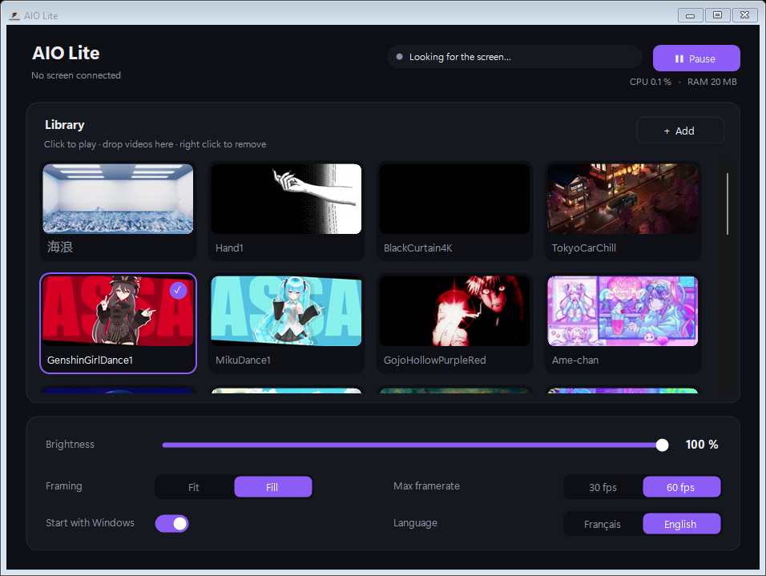

<div align="center">


# AIO Lite

**A tiny, no-bloat app to play videos on your AIO cooler screen.**
Made because the official app was eating ~10% of my CPU just to loop a video 😅




</div>

---

> [!WARNING]
> **I made this for ONE specific cooler: the [Lovingcool SC70 360](https://www.alibaba.com/product-detail/LOVINGCOOL-SC70-ARGB-Gaming-Cooler-Built_1601851951096.html) (6.67" screen).**
> That's the only one I own, so it's the only one I tested. It might not work with yours, even if it looks similar.
> Check the [Compatibility](#-compatibility) section before trying it.

## 🤔 Why?

I have a **[Lovingcool SC70 360](https://www.alibaba.com/product-detail/LOVINGCOOL-SC70-ARGB-Gaming-Cooler-Built_1601851951096.html)** AIO with a 6.67" screen on the pump. It's cool, but the official software (LOVINGCOOL MONITOR) is a huge Electron app.
To show a video it renders a hidden web page, screenshots it up to 60 times per second, re-encodes every frame to JPEG and sends it over USB.
Result on my PC: **~10% CPU and hundreds of MB of RAM**, all the time, just for a looping video.

So I made my own. It does one thing: put your video on the screen, and stay out of the way.

| | Official app | AIO Lite |
|---|---|---|
| CPU while playing | ~10% | **~0.2% (30 fps) / ~0.4% (60 fps)** |
| RAM in background | 300+ MB | **~20 MB** |
| Install size | ~400 MB | **~500 KB** |

*(measured on my PC, Ryzen 7 5800X / 16 threads, window closed, see [my setup](#my-pc))*

## 🧩 Compatibility

### ✅ Tested (the only one)

| | |
|---|---|
| Cooler | [Lovingcool SC70 360](https://www.alibaba.com/product-detail/LOVINGCOOL-SC70-ARGB-Gaming-Cooler-Built_1601851951096.html) |
| Screen | 6.67" AMOLED, 2400×1080, mounted at 90° |
| Model reported by the screen | `D215-NOR-JD9365-6.67inch-hor` |
| Firmware | `4.0` |
| USB ID | `VID 33C3` / `PID 7791` (shows up as a COM port) |
| OS | Windows 11 Pro (build 26300) |

### My PC

The rest of the setup I tested on, so you can compare the CPU / RAM numbers with yours:

| | |
|---|---|
| CPU | AMD Ryzen 7 5800X (8 cores / 16 threads) |
| GPU | NVIDIA GeForce RTX 3060 Ti |
| RAM | 40 GB DDR4 @ 2666 MT/s (4 sticks) |
| Motherboard | MSI MPG B550 GAMING EDGE WIFI |
| OS | Windows 11 Pro, build 26300 |
| .NET | Windows Desktop Runtime 10.0.1 |
| ffmpeg | 8.0.1 (gyan.dev full build, installed with winget) |

Everything in this README (the protocol, the frame size, the perf numbers...) comes from this one setup.

### 🤷 Might work, but NOT tested

The official software is made by a company (HT) that sells the same screen platform to a lot of brands, so in theory other coolers could work too:

- Other Lovingcool models, or other brands using the same screens (USB `VID 33C3`)
- Same screen with another firmware version
- Other screen sizes (480×480, 960×960, 3.5", 4.0"...): the code reads the size and angle from the screen, so it *should* adapt, but I really have no idea

If you try it on something else, **please open an issue** and tell me if it worked or not (with your cooler name and the JSON the screen returns for `0x06`). I'll add it to this list.

### ❌ Won't work (for now)

- **SPI screens**: they use raw RGB565 frames, not JPEG
- **Old firmware (2.8 and below)**: the image packet format is different
- Screens that use HID or other protocols instead of a COM port (some keyboards / LED panels supported by the official app)
- Linux / macOS (Windows only)

> Use it at your own risk. It only sends the same "live mode" commands as the official app and never touches the firmware, but I can't promise anything for a cooler I don't have.

## Features

- plays videos, gifs and images on the screen (mp4, mkv, mov, webm, gif, png, jpg...)
- a library with thumbnails, you can just drag & drop files in it
- on first launch it grabs the videos from your Lovingcool themes so you don't have to re-add them
- brightness, fit / fill mode, up to 60 fps (only if the video itself is 60 fps)
- starts with Windows by itself (first launch) and stays in the tray
- replaces the official app: it force closes LOVINGCOOL MONITOR if it's running and offers to uninstall it for you (your videos are copied first)
- reconnects by itself if you unplug the screen or after sleep
- the window is only created when you open it, so it doesn't use RAM when it's closed
- english and french (uses your Windows language by default)

## 🧠 How it works

The trick is simple: **do the heavy work once, not every frame.**

1. When you pick a video, `ffmpeg` converts it **one time** into a cache file (`.aio`) that already contains every frame as a JPEG packet, rotated and sized for the screen.
2. After that, playing is just: read packet from file → write to serial port → wait until next frame. No decoding, no rendering, no browser.
3. Brightness is baked in during conversion, because the screen ignores the hardware brightness command in live mode (found that out the hard way).

```
video.mp4 ──ffmpeg (once)──> cache/xxxx.aio ──read + write──> COM port ──> AIO screen
```

### The protocol (for the curious)

I figured this out by reading the official app's code. The screen is a USB serial device (`VID 33C3`, `PID 7791` on mine), 2 000 000 baud.

**Command frame**

```
55 AA | len (u16 LE, = payload + 7) | cmd | payload | checksum (u16 LE, sum of all previous bytes)
```

| cmd | what it does |
|---|---|
| `0x06` | get device info (answers with JSON: size, angle, model, firmware...) |
| `0x11` | start live mode (resend every ~1.5 s as a keep-alive) |
| `0x03` | hardware brightness (ignored in live mode 🙃) |
| `0x01` | restart |

`FF D9 FF D9` (raw, no frame) stops live mode.

**Image packet** (firmware > 2.8)

```
len (u32 LE) | JPEG bytes | checksum (u16 LE, sum of len + JPEG)
```

On the 6.67" screen (native 2400×1080, mounted at 90°) the frames are sent as **540×1200 portrait JPEGs** (half res, same as the official app).

## 📦 Install

### Download

**One line install / update** (paste it in PowerShell):

```powershell
irm https://raw.githubusercontent.com/Quiiks/AioLite/main/install.ps1 | iex
```

It downloads the latest release into `%LOCALAPPDATA%\Programs\AioLite` and starts it (it adds itself to Windows startup on first launch).

Or by hand:

1. Grab `AioLite-win-x64.zip` from the [latest release](../../releases/latest)
2. Unzip it wherever you want (I use `%LOCALAPPDATA%\Programs\AioLite`)
3. Run `AioLite.exe`, it goes in the system tray. Turn on "Start with Windows" in the settings if you want it at startup

> The UI is in English or French 🥖 (it follows your Windows language, you can change it in the settings).

### Requirements

- Windows 10/11
- [.NET 10 Desktop Runtime](https://dotnet.microsoft.com/download/dotnet/10.0)
- [ffmpeg](https://ffmpeg.org/) in your PATH (or next to the exe). Easiest way:
  ```powershell
  winget install Gyan.FFmpeg
  ```
  If you still have the Lovingcool app installed, AIO Lite can also use the ffmpeg that comes with it.

### Build it yourself

```powershell
git clone https://github.com/Quiiks/AioLite.git
cd AioLite
dotnet publish -c Release -r win-x64 --self-contained false -o publish
```

Then run `publish\AioLite.exe`.

> Only one app can use the screen's COM port at a time. Since v1.1.1 you don't have to do anything: AIO Lite closes the official Lovingcool app on startup and asks if you want to uninstall it (it also removes the hidden scheduled task that relaunches it at every boot). You can do it later from the tray icon menu → *Replace LOVINGCOOL MONITOR…*

## 🕹️ Usage

- **Left click** the tray icon → open the window
- **Right click** the tray icon → pause / quit
- **Click** a video in the library → it plays on the screen (first time takes a few seconds to convert)
- **Right click** a video → remove it / open its folder
- Change brightness, Fit/Fill or max fps → the video gets re-converted once, then it's instant next time

Settings and cache are stored in `%LOCALAPPDATA%\AioLite` (cache is capped at 2 GB, oldest files get deleted).

### Debug flags

```powershell
AioLite.exe --tray                          # start hidden in the tray
AioLite.exe --snap ui.png                   # render the window to a png
AioLite.exe --encode-test video.mp4 out.txt # encode + check every packet of the cache
```

## 🗂️ Project structure

```
AioLite/
├── Program.cs    # entry point, single instance, debug flags
├── App.cs        # tray icon, settings, glue between everything
├── Device.cs     # serial protocol (find port, commands, packets)
├── Encoder.cs    # ffmpeg conversion to .aio cache + thumbnails
├── Player.cs     # playback thread (read file, write serial, high-res timer)
├── Settings.cs   # json settings, Lovingcool theme import, autostart
├── MainForm.cs   # the settings window
└── Ui.cs         # custom dark controls (toggle, slider, tiles...)
```

## 🛣️ Roadmap / ideas

- [ ] Show CPU / GPU temps on top of the video
- [ ] Playlist / shuffle mode
- [ ] Support other screens from the same family (other PIDs from `VID 33C3`)
- [ ] Self-contained release so you don't need the .NET runtime
- [x] English UI (added in v1.1)

PRs and issues are welcome! If you have another AIO with a screen and want to test, open an issue with the JSON your screen returns for `0x06`.

## ❓ FAQ

**Will it work with my AIO?**
Maybe! It was only tested on the Lovingcool SC70 360. See [Compatibility](#-compatibility), and if you try it, open an issue to tell me how it went.

**I chose 60 fps but it says 30?**
60 is a *max*. If your video is 30 fps there are only 30 frames per second to send.

**The screen shows nothing?**
Check that your screen shows up as a COM port in Device Manager. If the official app is still installed, use the tray icon menu → *Replace LOVINGCOOL MONITOR…* (it needs admin rights because the official app runs as admin).

**Is it safe for my cooler?**
It only uses the same commands the official app uses for live mode. No firmware stuff.

## 🙏 Credits

- [FFmpeg](https://ffmpeg.org/) for doing all the heavy lifting
- The Lovingcool / HT team for the hardware (this project is **not affiliated** with them)
- Inspired by all the great READMEs out there ([awesome-readme](https://github.com/matiassingers/awesome-readme) 👀)

## 📄 License

MIT. Do whatever you want with it, just don't blame me if your pump starts playing Rick Astley.
